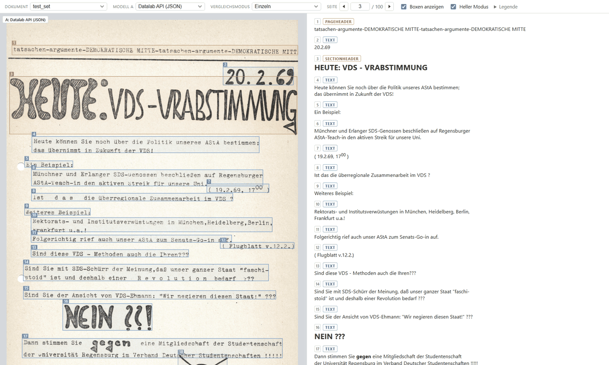
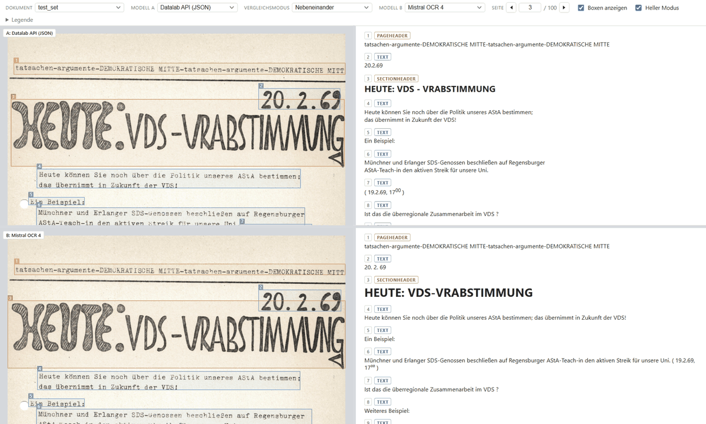
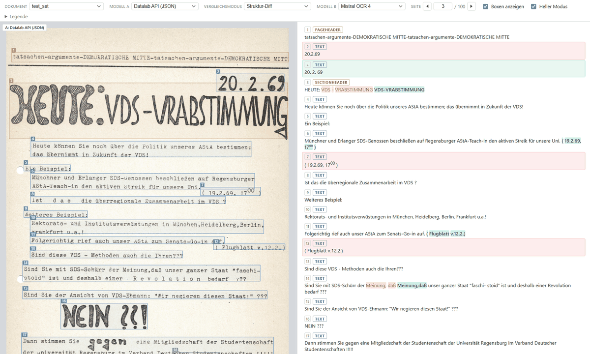
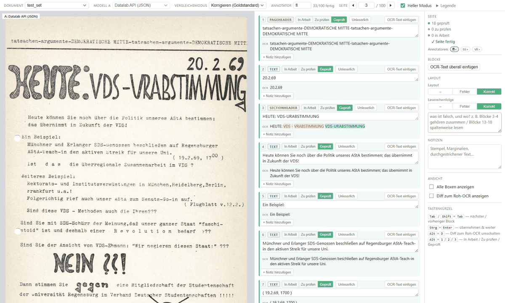

# OCR model comparison webapp

Local tool for visually comparing OCR model output (Datalab, MinerU,
PaddleOCR, GLM-OCR, ...) against the source PDF: page on the left with
detected boxes overlaid, extracted content on the right, numbered and synced
by hover/click — same idea as Datalab's own playground UI.



The **Vergleichsmodus** dropdown switches between four ways of comparing the
current document's models, all sharing the same document/page navigation:
- **Einzeln** — one model, the layout described above.
- **Nebeneinander** — two full model rows (PDF+boxes | content) stacked, Model
  A on top and Model B below (each row labelled so it's clear which is
  which), with a draggable divider between the two rows' heights, so
  misaligned/missed regions are visible at a glance without flipping the
  dropdown back and forth.
- **Wort-Diff** — model A's PDF+boxes on the left; on the right, a word-level
  diff of the two models' extracted text for the current page, flattened to
  one plain-text blob (LCS-based, `diff.js`), red for text only in A, green
  for text only in B, unstyled where they agree. Both sides are tinted rather
  than struck through — a line through the characters is exactly what you're
  trying to read when comparing a transcription against the OCR.
- **Struktur-Diff** — the same word-level diff, but keeping model A's
  block structure instead of flattening the page: bbox overlay, per-block
  type tags and numbering all stay, hover/click-synced between the page and
  the content list exactly like Single/Side-by-side. Blocks are aligned
  first (`alignBlocks` in `diff.js`) by word-overlap similarity, not exact
  match — two models' output for the same paragraph is essentially never
  byte-identical — then each matched pair is word-diffed; a block that only
  exists in one model shows as a whole-block insertion/deletion (tinted
  red/green) instead. Alignment quality depends on the two models
  segmenting the page similarly — if one merges several paragraphs a
  finer-grained model keeps separate, expect more block-level insert/delete
  noise instead of clean word-level diffs within a shared block.
- **Korrigieren (Goldstandard)** — an editing mode, not a comparison one: locks to
  the Datalab output and turns the content pane into editable per-block
  textareas for post-editing Datalab's text into a gold standard. See "Correct
  mode" below.





Model names in the dropdowns are prettified for readability (e.g. "Datalab
API (JSON)" instead of the raw output folder name "jsonDatalab") — see
`MODEL_DISPLAY_NAMES` in `app.js`. The underlying folder/file name is still
used for matching and deep-link URLs, so links stay stable even if a label
changes.

The **Heller Modus** checkbox toggles the theme; the choice is remembered
(`localStorage`) and otherwise defaults to the OS's `prefers-color-scheme`.
Applied via a `data-theme` attribute on `<html>` — see the inline `<script>`
at the top of `index.html` (sets it synchronously, before first paint, so
there's no flash of the wrong theme) and the `:root[data-theme="light"]`
overrides in `style.css`.

## Run

```bash
python ocr_viewer/server.py           # defaults to port 8000
```

Open http://127.0.0.1:8000/. The document list is built by scanning `data/`
fresh on every page load, so newly generated OCR output shows up on refresh
with no restart needed. `test_set` loads by default if present (falls back to
the first document found otherwise); the model dropdown always shows the raw
output-directory name (e.g. "jsonMistral", "MinerU") so it's obvious which
folder on disk a given entry came from.

## Correct mode (gold standard)



Correct mode produces the gold transcription we measure Datalab's CER against
(see [../pipelines/03_eval/](../pipelines/03_eval/)). Pick **Korrigieren
(Goldstandard)** in **Vergleichsmodus** and type your initials in the
**Annotator** box — next to it, a counter shows how many of that annotator's
pages are complete for the current document (`GET /api/annotator-progress`,
server.py). If more than one annotator has saved the *current* page, the
sidebar's **Annotatoren:** row (always visible, not behind a click) lists
them as clickable chips — a filled dot marks a complete copy, the current one
is highlighted — so switching to someone else's version of this page is one
click instead of retyping their initials from memory
(`GET /api/page-annotators`, server.py).

The interface itself is German (the annotators are); code, comments and this
README stay English, so UI labels appear here in German and everything around
them in English.

- The middle pane becomes one auto-sized `textarea` per Datalab block, always
  starting **empty** — the annotator transcribes each block from the scan
  without being anchored by the OCR text. Every control for a block lives
  right on it, nothing requires a trip to the sidebar: in the header line, its
  type as a colour-coded badge (same per-type colour as the block's number
  chip and its box on the scan — the type is what the Classification review
  judges, so it has to be readable without hunting), a 3-state toggle, an
  **Unleserlich** button, and (pushed to the right)
  an **OCR-Text einfügen** button that accepts the OCR text as-is with one
  click instead of retyping something that's already correct — or, on
  annotator-added blocks (which have no OCR text), a **✕ Block entfernen**
  button in that same spot instead. Below the text, a **+ Notiz hinzufügen** button
  reveals a small text field for anything about that specific block (✕
  removes it again). The Seite section's **OCR-Text überall einfügen** does the same
  as the per-block button for every block on the page at once (overwrites
  whatever's already there).
- Focusing a block highlights its box, scrolls the scan to it, and marks it
  as the *current* block: a glow ring around it in its review-state color
  (see below), scrolled to the top of the list (the block list has extra
  scroll room below the last item so even it can reach the top). Only one
  block is ever current at a time. `Tab`/`Shift+Tab` jump straight from one
  block's main field to the next's — the toggle/Unleserlich/Einfügen/Notiz
  buttons are click-only, skipped in the tab order, so they don't get in the way.
- Only the selected block's box is drawn on the scan by default — with ~20
  boxes on a page, showing all of them makes the scan hard to read while
  transcribing; every box stays clickable, just visually hidden until it's
  the active one (or hovered, on the scan itself). **Alle Boxen anzeigen** (in the
  Seite section's Layout group) overrides this to audit the whole layout at once.
- **Block state** — a colored left border on the block, matching its inline
  3-state toggle:
  - **In Arbeit** (blue) — never confirmed since it was last empty. No diff
    shown yet, so a first blind read isn't spoiled by the answer.
  - **Zu prüfen** (yellow) — confirmed at least once (blurred /
    `Ctrl+Enter`) and has text. The OCR text is now shown beneath as a word
    diff and *stays* shown and live-updating as you keep refining the text —
    it does not hide again just because you're still typing. Reaching this
    state is always automatic, including when the text matches the OCR
    exactly: agreement is a good sign, not proof, so it's never enough on its
    own to call something Geprüft.
  - **Geprüft** (green) — only ever reached by the annotator's deliberate
    choice, clicking that button on the toggle. Never set automatically.
  Clicking any of the three jumps straight to that state (e.g. mark something
  Geprüft without editing it, or send a mistaken Geprüft back to Zu
  prüfen) — it's a direct-set toggle, not a checkbox. Changing it updates the
  block in place; the list doesn't reshuffle or reset your scroll position.
- **Unleserlich** (next to the toggle) — source can't be read; excludes the
  block from scoring.
- A page is **complete** once every block is Geprüft or Unleserlich *and*
  **both** layout ratings have been set (see below). There's no separate
  "I've checked the layout" confirmation: nothing is pre-rated, so having a
  rating at all *is* the confirmation. The status line is one line with one
  count per half — `offen: 12 Blöcke, Layout`, or `✓ Seite fertig`. That's
  the same `complete` flag the eval script's `--all` filter reads.
- **Picture/Figure blocks** aren't transcribed (their "OCR text" is just an AI
  image description): the block shows the image itself; its Note (same
  **+ Notiz hinzufügen** control as any other block) is its only annotation. Excluded
  from CER scoring. (`NON_TEXT_TYPES` in `app.js` and in
  `pipelines/03_eval/build_dinglehopper_inputs.py` — keep them in sync.)
- **Seite** (sidebar) combines page-level progress/options and whole-page
  layout review, split into sub-groups by labelled horizontal rules (no nested
  boxes — in a 240px column each inset frame and its padding cost usable width
  the code checkboxes need) so the bulk action doesn't blend into the review
  checklist:
  - Progress summary and the automatic completion status described above.
  - **Blöcke**: **OCR-Text überall einfügen**.
  - **Layout**: two whole-page ratings (see below) plus, on the
    topbar-adjacent **Ansicht** group, **Alle Boxen anzeigen** — every
    block's box at once (with reading-order numbers), instead of just the
    focused block's; this is the control to turn on while actually checking
    reading order, and it overrides the topbar's own "Boxen anzeigen"
    (hidden in Correct mode — the sidebar one is the only box toggle here,
    so it can't be left showing nothing with no visible reason). Both
    ratings are saved into the gold standard and surfaced in the eval
    script's `structural_report.csv`.
  - **Notizen**: a per-page **note** field for anything the other guidelines
    don't cover (stamps, marginalia, struck-through text).
  Below the Seite group: **Diff zum Roh-OCR anzeigen** (or `Alt+D`) shows a word diff
  of your correction against Datalab's raw text — per block (a strip under
  each changed block) and, toggled on, for the whole page (red = raw OCR
  removed, green = correction added). Like **Alle Boxen anzeigen**, it's a viewing
  preference only (remembered locally), not saved into the gold.

### Layout review

Two whole-page ratings, sharing one note field:

| Rating | The question it asks |
|---|---|
| **Layout** | Are the regions right — boundaries where a unit of content starts and ends, correctly typed once bounded? Split, merged, missed, spurious or mislabelled blocks all land here. |
| **Lesereihenfolge** | Do the blocks come out in the order a reader would follow? Turn on **Alle Boxen anzeigen** to see the numbering on the scan. |

Each is rated **–** (unrated) / **Korrekt** / **Fehler** — same scale, same
polarity, no default, so an untouched rating is never mistaken for a checked
one. This mirrors the two-checkbox-plus-note structure ("Layout has errors" /
"Reading order correct") the annotators who didn't use this tool actually
used, kept separate because "the regions are wrong" and "the order is wrong"
are worth reporting apart. A single combined rating and a fully separate
third dimension (classification) were both tried in between — the combined
version made the two indistinguishable again, the three-way split cost more
time per page than the extra precision was worth.

Rating **Fehler** on either shows the text field: write what is wrong and
where (`Blöcke 3-4 gehören zusammen`). **It can't be left empty while either
rating is Fehler** — an unexplained error is a finding nobody can act on, so
the page stays incomplete until it says something. It only clears once
*neither* rating is Fehler any more, since it may describe either one.

In the saved JSON:
`"layout": {"general": {"rating": …}, "reading_order": {"rating": …}, "note": …}`.

**Transcription conventions.** The gold standard is plain text scored per
character, so:
- **Super/subscripts** (e.g. `17` with a superscript `00` for a time): type the
  plain inline characters — `1700`. Datalab flattens `<sup>` the same way, so
  this scores as correct with no special markup.
- **Soft line breaks** inside a paragraph are just spaces — the extraction and
  scoring both treat them that way (see below), so type one line.
- Keyboard: `Tab`/`Shift+Tab` between blocks, `Ctrl+Enter` commit & next,
  `Alt+D` diff, `Alt+1`/`2`/`3` set the focused block's review state directly
  to In Arbeit/Zu prüfen/Geprüft.

Edits **autosave** (debounced) to
`data/<dataset>/gold/annotations/<annotator>/page_<NNN>.json` via the server's
`POST /api/save-annotation` endpoint; block ids are preserved so the gold and
OCR stay 1:1. Because the annotator is part of the path, several people's
versions of the same page coexist. Reopening a page reloads the saved gold.

## Adding a model's output

Drop the model's output next to the existing ones for a document — any of
these layouts are picked up automatically (see `manifest.py` for the exact
rules):

```
data/<dataset>/<doc_id>.pdf
data/<dataset>/<doc_id>/<model>.json        # e.g. glm.json
data/<dataset>/<doc_id>/<doc_id>.json       # datalab_convert.py's default output -> shown as "datalab"
data/<dataset>/MinerU/<doc_id>_middle.json  # MinerU's output dir, as-is
data/<dataset>/PaddleOCR/<doc_id>_<page>_res.json  # PaddleOCR's per-page output dir, as-is
data/<dataset>/markdownDatalab/<doc_id>.md  # markdown-only output (no boxes), as-is
data/<dataset>/GLM-OCR/ergebnisse/<anything>_<page>.txt  # any tool's plain-text-per-page output (no boxes), as-is
```

All but the first two match a given tool's own default output folder/file
names verbatim — just point the tool at `data/<dataset>/` and nothing needs
renaming. The last (numbered `.txt` files) works for any per-page
plain-text output, not just GLM-OCR's `ergebnisse/seite_NNN.txt`, since it's
matched by "2+ files ending in digits.txt", one level deep, not by tool name.

Images referenced from a block's `html` (``) are resolved
relative to that model's own output directory, so keep them alongside the
JSON/markdown (all of the above tools already do this).

## Adding a model's JSON format

The frontend normalizes every model's output into a common shape before
rendering: `{ pages: [{ width, height, blocks: [{ id, type,
bbox: [x0,y0,x1,y1], html }] }] }` (bbox is in the same coordinate space as
the page's width/height — only the ratio matters, not the unit).

- **Single JSON file per document** (Datalab, MinerU, Mistral, Gemini): add
  an adapter in `adapters.js` — implement `matches(data)` and
  `normalize(data, pdfPageSizes)` — and register it in the `ADAPTERS` list.
  `normalize` is tried against whatever `JSON.parse` of the fetched file
  produces; auto-detected by `matches()`, no manifest changes needed as long
  as the file is named `<doc_id>.json` (or `<doc_id>/<model>.json`).
  - Mistral (`{ pages: [{ index, markdown, blocks?, dimensions? }] }`) uses
    real per-block boxes (`blocks[].top_left_x/y, bottom_right_x/y` in the
    coordinate space given by `dimensions.{width,height}`) when a page has
    them, falling back to the whole-page `markdown` blob (no boxes) for
    pages/runs that don't — the format has grown richer between runs, this
    adapter still handles the earlier markdown-only shape.
  - Gemini (`{ model, text }`) is one markdown blob for the whole document
    with `### Page N` / `# Seite N` headings as page separators — matched
    loosely (any heading level, "Page" or "Seite") since the exact wording
    has already varied between runs. No boxes; reuses `markdownToHtml()`,
    same as the markdown-only formats below, just JSON-wrapped.
- **One JSON file per page** (PaddleOCR): `matches(data)` receives the array
  of all per-page files' parsed JSON instead of a single object. Wire the
  folder up in `manifest.py`'s `_scan_dir` the way PaddleOCR's
  `<doc_id>_<page>_res.json` pattern is handled.
- **No JSON at all, one blob for the whole document** (markdownDatalab,
  markdownMistral): bypasses adapter auto-detection entirely — see
  `normalizeMarkdown()` and the `kind: "markdown"` handling in `app.js`'s
  `selectModel()`. No boxes, since plain markdown doesn't carry per-block
  structure — but it can still carry per-*page* structure if the file joins
  pages with a lone `---` line, the way `mistral_convert.py --format
  markdown` does. `normalizeMarkdown` splits on that separator and treats
  the result as real per-page content whenever it yields exactly as many
  chunks as the PDF has pages (`numPdfPages`, from pdf.js) — a `---` inside a
  page's own markdown (a real horizontal rule) is indistinguishable from a
  page separator, so the count check is what keeps a stray in-content `---`
  from mis-splitting the document. If the count doesn't match (e.g.
  `datalab_convert.py --format markdown` run without `--paginate`, which
  emits no separators at all), it falls back to one single full-page block
  on page 1 — pass `--paginate` when generating Datalab markdown output if
  you want it to split properly here too.
- **No JSON at all, one file per page** (GLM-OCR): same idea but per page —
  see `normalizeTextPages()` and `kind: "text_pages"`. Each page becomes one
  full-page block, no boxes.
- **No page-size field in the format itself** (PaddleOCR): `pdfPageSizes[i]`
  (the PDF's own page size in points, from pdf.js) is passed into
  `normalize()` as a fallback reference — see `normalizePaddleOcrPages` for
  the pattern (it also documents the empirically-derived 2x render-scale
  assumption; re-derive that constant if a different tool's output doesn't
  match it).

## Files

- `server.py` — static file server + `/api/manifest` and `/api/save-annotation`
  (Correct mode's autosave) endpoints
- `manifest.py` — scans `data/` for documents and their per-model JSON outputs
- `index.html` / `style.css` / `app.js` — the frontend
- `adapters.js` — per-model JSON → common shape normalization
- `diff.js` — word-level LCS diff between two models' extracted page text,
  plus block-level alignment (`alignBlocks`) for the structured diff mode
- `sanitize.js` — whitelist HTML sanitizer for rendering block content. It
  drops *every* attribute except `img[src]`/`img[alt]`, `style` included, so
  any presentation a model expressed inline has to be reasserted in
  `style.css`. Datalab's lists are the case that matters: it emits
  `<ol style="list-style-type: none">` because the document's own numbering
  ("4.)", "II.", "---") is already in each item's text, and without that style
  the browser adds a second set of markers. See the `.html-content ol/ul` rule.
- `vendor/` — vendored pdf.js (ESM build)
